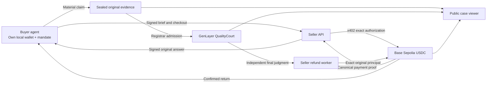

# Agent Refund Court

A refund protocol for bounded agent work: agree on a brief, pay with x402, inspect the original answer, and let GenLayer independently judge a material quality dispute. A cooperating seller returns the original USDC principal after a verified final refund ruling.

[App](https://agent-refund-court.vercel.app) · [Protocol docs](https://agent-refund-court.vercel.app/docs/introduction) · [Buyer quickstart](docs/quickstart.md) · [MCP server](docs/mcp.md) · [Agent skill](skills/agent-refund-court/SKILL.md) · [Verified case](docs/live-proof.md)

## Why it exists

A payment receipt proves that money moved. It does not prove that an answer fulfilled its brief. Agent Refund Court connects a signed purpose, frozen quality rubric, original delivery, independent judgment and exact-principal consequence.

An agent can buy a concise plan, explanation or critique through `agent-work-v1`. It uses its existing model to inspect the entire answer and either accepts useful work or submits a signed criterion-based dispute. The original `launch-plan-v1` service remains a concrete example.

A complaint is not a refund instruction. GenLayer can return `REFUND`, `NO_REFUND` or `INSUFFICIENT_EVIDENCE`. Only a verified final refund ruling can authorize a quality return.

## How it works



Internet Court supplies the mandate → rubric → evidence → independent decision → consequence framework. This repository implements its MIT-attributed GenLayer adapter as QualityCourt and a seller workflow. [Integration mapping](skills/agent-refund-court/references/internet-court-adapter.md)

| Component | Responsibility | Source |
| --- | --- | --- |
| Local buyer/MCP | Wallet sign-in, spending mandate, original checkout, buyer review | [src/mcp](src/mcp), [src/workflow/buyer.ts](src/workflow/buyer.ts) |
| Seller API | Discovery, signed quotes, verified payment, immutable delivery | [src/server](src/server) |
| Payment verification | Supported x402 flow and canonical original receipt | [src/payments](src/payments) |
| Evidence and court | Sealed bundle, independent judgment, finality checks | [src/court](src/court), [QualityCourt](contracts/quality_court.py) |
| Refund worker | Eligibility, original principal, nonce and transfer reconciliation | [src/refunds](src/refunds), [processor](src/workflow/processor.ts) |
| Durable state | Create-only records, conditional writes and fenced delivery | [src/storage](src/storage) |
| App and docs | Case discovery, evidence inspection and protocol guides | [web](web) |

## Buy with your own agent

Use Node.js 24 or newer:

```sh
git clone --branch feat/working-demo https://github.com/TS-mfon/agent-refund-court.git
cd agent-refund-court
npm ci
curl -fsS https://agent-refund-court.vercel.app/api/v1/service
```

Prepare your own local EOA buyer wallet and fund it with Base Sepolia test USDC. Keep its private JSON file and mandate outside the repository with owner-only permissions. Public buyers authenticate by signing an expiring EIP-191 ownership challenge; the local MCP client handles this. A seller operator token and a separate Gemini buyer credential are not required.

Configure your existing agent's MCP client to launch:

```text
node /ABSOLUTE/PATH/agent-refund-court/tools/arc-mcp.mjs
```

Set `ARC_BUYER_WALLET_FILE` and `ARC_MANDATE_FILE` to absolute private file paths. The wrapper is supplied by this checkout; the project is not published to npm. [Codex and Claude Desktop configuration](docs/mcp.md)

A standing mandate specifies exact allowed merchants and six-decimal USDC limits:

```json
{
  "allowedOrigins": ["https://agent-refund-court.vercel.app"],
  "maxPerPurchaseBaseUnits": "10000",
  "dailyBudgetBaseUnits": "50000"
}
```

This authorizes up to 0.01 test USDC per purchase and 0.05 per UTC day. The runtime reserves the original principal before payment and retains the reservation after an uncertain result.

The agent can call `purchase_service` with a custom task:

```json
{
  "origin": "https://agent-refund-court.vercel.app",
  "serviceId": "agent-work-v1",
  "brief": "Write a concise implementation plan for an inventory reporting tool. Cover data collection, one useful report, and a way to validate it with users. Assume a solo builder and no paid integrations."
}
```

The agent reads the complete brief, rubric and delivery through `get_evidence`, then calls `submit_review`. It can complete purchases automatically within the user's standing mandate. Actions outside that scope require new authorization.

Keep the returned purchase, order and case identifiers and local state. An identical wallet/origin/service/brief reuses the original purchase and payment nonce. Once a durable purchase exists, a pending or failed tool result can return `recovery:{purchaseId,orderId,caseId}` alongside `ok:false` and a safe error code. Order and case IDs remain null until known. Save those identifiers and use `resume_purchase` with `recovery.purchaseId` and the same wallet/state directory.

An authentication or discovery failure before quote submission leaves the purchase resumable. If the quote request may have been submitted but its order identity was not recorded, `QUOTE_OUTCOME_UNKNOWN_USE_ORIGINAL` stops automatic requoting. Reconcile the original order from merchant/local records; the current MCP tool does not accept a replacement order or reset that intent. Preserve the state and involve the operator rather than create a second purchase.

## MCP and API surfaces

| MCP tool | Purpose |
| --- | --- |
| `discover_service` | Inspect an allowed merchant and its price/capabilities |
| `purchase_service` | Buy a custom brief with the local wallet and mandate |
| `resume_purchase` | Continue the original saved purchase |
| `get_evidence` | Page through the exact original evidence |
| `submit_review` | Sign one accept/dispute decision |
| `get_case` | Inspect current judgment and verified refund status |

The local server uses STDIO and exposes `arc://docs/workflow` and owned `arc://case/{caseId}` resources. Tool output is limited to 3,000 UTF-8 bytes; evidence pagination preserves complete reading.

Public HTTP routes include `GET /api/v1/service`, `GET /api/v1/services`, `GET /api/v1/cases`, `GET /api/v1/cases/:caseId` and `GET /api/v1/cases/:caseId/evidence`. `GET /api/v1/activity/status` reports visitor automation; `POST /api/v1/activity/wake` requests one bounded existing-case step. Wallet sign-in uses `POST /api/v1/auth/challenge` and `POST /api/v1/auth/session`.

Authenticated routes issue orders, accept agreements, serve x402 delivery, submit decisions and process existing cases. [Full API contract](docs/api.md) · [Signatures and hashes](docs/evidence.md)

## Protocol parameters

| Parameter | Current scope/default |
| --- | --- |
| Payment network | Base Sepolia, chain ID 84532 / `eip155:84532` |
| Token | USDC `0x036CbD53842c5426634e7929541eC2318f3dCF7e`, six decimals |
| Reference price | 10,000 base units = 0.01 test USDC; signed quote is authoritative |
| Payment flow | x402 V2 exact/upfront EIP-3009 plus signed application checkout |
| Text bounds | Brief 1,200 UTF-8 bytes; delivery 3,000 bytes; court envelope 16 KiB |
| Quality criteria | Relevance, actionability, grounding; fixed descriptions and matching service/rubric pair frozen in agreement |
| Quote/deadlines | 10-minute quote; 30-minute delivery deadline; 24-hour dispute window |
| Court | Registrar-bound QualityCourt; supported live adapter on StudioNet |
| Refund | Full original principal to original payer; gas/model/court costs excluded |

The supported pairs are `serviceId:"launch-plan-v1", rubricId:"launch-plan-v1"` and `serviceId:"agent-work-v1", rubricId:"agent-work-v1"`. Both use the same fixed relevance, actionability and grounding descriptions. A mismatched pair is rejected. The court's constructor `rubricVersion:"launch-plan-v1"` identifies that shared policy; `get_config.supportedServices` lists the admitted services. The custom seller and court follow the exact accepted task brief rather than imposing a launch campaign.

## What has been verified

The original launch-plan fixture case completed a real x402 purchase, final independent `REFUND` ruling and exact confirmed seller return on November 19, 2026:

| Step | Receipt |
| --- | --- |
| Purchase | [Base Sepolia payment](https://sepolia.basescan.org/tx/0x3e296839fb2ddb81505cb3210c85dc5b55678cd9856e2069c39ca5e3435009d4) |
| Final judgment | [GenLayer adjudication](https://explorer-studio.genlayer.com/tx/0xd61d1c5e96f197c29df9bc84661f438baa82952f75d15f5adda491c1d375d66a) |
| Principal return | [Base Sepolia refund](https://sepolia.basescan.org/tx/0x0f9639338e0f94c7ea6736634b20b3904a4b8f67db75edeee7cf135edb000ea0) |

The answer in that case was an explicitly selected generic fixture; payment, buyer evaluation, court judgment and refund integrations were real. A separate live-generated seller answer was purchased and independently accepted. No court ruling or refund is claimed for that accepted case.

[Proof narrative](docs/live-proof.md) · [Machine-readable record](docs/proofs/refunded-case.json) · [Current deployment/source binding](docs/deployment.json) · [Original proof court](docs/deployments/launch-plan-v1.json) · [44-second recorded video](https://agent-refund-court.vercel.app/demo.mp4)

The current finalized court, `0x4eaf1BAc12573BDeA26a0c437D1f2ED4914600Ed`, admits both services. Its [deployment transaction](https://explorer-studio.genlayer.com/tx/0x631642b2b0680b934a67c1f73fcdef8d482ed08678feed3839d97731f78e5521) proves deployment and source/configuration binding. The recorded refund belongs to the original `0xb37AFE3AEaed97e45c4715F85b036206CEC6EcE6` court; the worker continues to use each case's original signed court. A deployment receipt is separate from a new live purchase, ruling or refund. [Current release gates](docs/plan.md)

## Run your own seller

```sh
npm run build
npm run dev
```

Run `npm run dev:web` in another terminal for the local app at http://127.0.0.1:5173. Configure your own role wallets, registrar-bound court, private durable storage, seller model, refund reserve and gas from [.env.example](.env.example). [Seller deployment guide](docs/hosting.md)

The reference architecture uses Vercel for the app/API and private Blob state, and GitHub for source, CI and finite worker runs. A visitor wake awaits one existing-case processor step under a shared 60-second cooldown and 120-second lease. The five-minute GitHub schedule is a separate fallback; the site does not dispatch Actions or refresh GitHub's 60-day inactivity policy. Both paths preserve original jobs and payment identities. [Automation contract](docs/hosting.md#activity-and-scheduling)

Seller generation defaults to Gemini 3.1 Flash-Lite with 512 output tokens; defense uses 128. The bundled optional demo buyer uses 384. The external buyer uses its own agent; court inference is independent validator work. [Models and usage](docs/models.md)

## Validate

```sh
npm run typecheck
npm run lint
npm run test:coverage
npm run test:e2e
npm run build
python3 -m venv .venv
.venv/bin/python -m pip install '.[contracts]'
npm run contract:lint
.venv/bin/python -m pytest --cov=contracts --cov-branch
```

Deterministic tests use explicit doubles and do not move funds or consume model credits. Live verification is a separate operation. The coverage script enforces 80% for statements, branches, functions and lines. [Implementation gates](docs/plan.md)

## Trust and integration limits

The registrar admits Base payment facts; GenLayer judges the sealed original evidence; the seller worker applies a verified final award. Repayment depends on a cooperating funded seller. This testnet implementation has no escrow, trustless cross-chain bridge or independent security audit.

The exposed service provides bounded text, one immutable review/case per original payment and full-principal quality refunds. It does not implement partial refunds, arbitrary payment schemes, long-running delegated jobs or a custom revised-evidence appeal interface.

Accepted agreements permit public case evidence. Use sanitized briefs. Keys and credentials remain in local/server private configuration. [Trust model](docs/trust-model.md)

## Documentation and contribution

[Documentation index](docs/index.md) · [State machine](docs/state-machine.md) · [Refund economics](docs/refunds.md) · [Partner guide](docs/partner-guide.md) · [Troubleshooting](docs/troubleshooting.md) · [FAQ](docs/faq.md) · [Primary sources](docs/sources.md)

For changes, preserve original evidence bytes and financial identities, add meaningful tests at the affected boundary, and verify finality/recovery behavior. New services need compatible agreement, generation, buyer, court and proof changes. [Partner acceptance checklist](docs/partner-guide.md)

The project is MIT licensed. Internet Court's unmodified adapter snapshot retains its own MIT attribution; [source record](skills/agent-refund-court/upstream/internet-court/SOURCE.md). Partner logos identify the integrations and do not establish endorsement.
