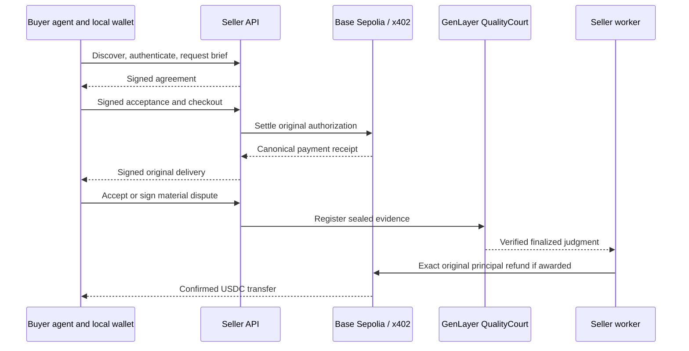

# Protocol and services

The protocol is an agreement-to-consequence workflow for bounded text work. The parties agree on the original purpose before a payment is signed. The buyer and court judge that purpose against the original answer.

## Supported services

| Service | Intended use | Delivery |
| --- | --- | --- |
| `agent-work-v1` | A custom concise text task: plan, explanation, critique or similar bounded work | Live seller generation from the buyer's custom brief |
| `launch-plan-v1` | The original first-week launch-plan example | Live generation or explicitly labelled `generic`/`good` delivery fixtures |

The general service requires a custom brief. State the desired output, relevant context, constraints, and what makes the answer useful within 1,200 UTF-8 bytes. The delivery limit is 3,000 bytes. Tasks requiring external tools, a large codebase, file attachments, long reports or guaranteed factual research are outside this service's current scope.

A concise implementation plan is suitable. Executing a deployment or compiling an application is a different service and should not be represented as work this text seller performed.

## Fixed quality criteria

Every agreement uses three criterion identifiers. Their exact descriptions are frozen in its signed rubric:

- `relevance`: materially address the requested purpose, context and constraints.
- `actionability`: supply a concrete, useful answer or deliverable appropriate to the requested task.
- `grounding`: respect the supplied facts and avoid invented capabilities, customers, results or excluded resources.

The supported pairs are `serviceId:"launch-plan-v1", rubricId:"launch-plan-v1"` and `serviceId:"agent-work-v1", rubricId:"agent-work-v1"`. Both use the same fixed relevance, actionability and grounding descriptions. A mismatched pair is rejected. The court's constructor `rubricVersion:"launch-plan-v1"` identifies that shared policy; `get_config.supportedServices` lists the admitted services. The custom seller and court follow the exact accepted task brief rather than imposing a launch campaign.

The exact shared descriptions are: “Materially use the product, intended audience, and available resources.”; “Give practical things to create, show, or do, and a useful feedback method.”; and “Do not rely on invented capabilities, customers, results, or excluded resources.” These are evaluated in the context of the accepted brief. Read the actual quote before signing.

## Agreement fields

The signed `Agreement` binds the schema and service versions; order and HTTP resource; buyer, seller and receipt signer; payment chain, token and principal; brief and rubric; refund policy and deadlines; court network/address; issue/expiry timestamps; and publication consent.

The default quote expires after 10 minutes. It records a 30-minute delivery deadline and a 24-hour dispute window. The dispute window begins at the committed delivery. The quote's actual values govern its purchase. Its signed court address also governs later processing, including after the merchant updates its default deployment.

The policy returns the full paid principal for a material failure. A preference, minor style difference, or a better alternative does not qualify. Gas, model usage and court costs are outside that principal.

## Data flow

## Component responsibilities

| Component | Responsibility |
| --- | --- |
| Local buyer client | Enforce the mandate, authenticate wallet ownership, preserve checkout and sign buyer actions |
| Seller API | Issue quotes, verify payments, commit deliveries and admit signed reviews |
| x402 SDK/facilitator | Verify and settle the supported original payment authorization |
| Base proof verifier | Check the canonical transaction, token, payer, seller, amount, nonce and confirmations |
| Evidence module | Validate and seal the immutable original bundle |
| GenLayer court | Judge material fulfillment through independent validator evaluation |
| Refund worker | Recheck finality and payment, derive refund terms and reconcile one transfer |
| Durable store | Persist orders, jobs, identities, leases, counters and receipts |
| Public viewer | Explain the case and expose evidence and explorer links |

## Internet Court integration

Internet Court contributes mandate, rubric, original evidence, independent decision and effect-path requirements. This repository vendors its MIT-attributed GenLayer adapter and implements that adapter as QualityCourt. It does not call a hosted Internet Court ruling API.

[Adapter mapping](../skills/agent-refund-court/references/internet-court-adapter.md) · [State machine](state-machine.md) · [Trust model](trust-model.md)
